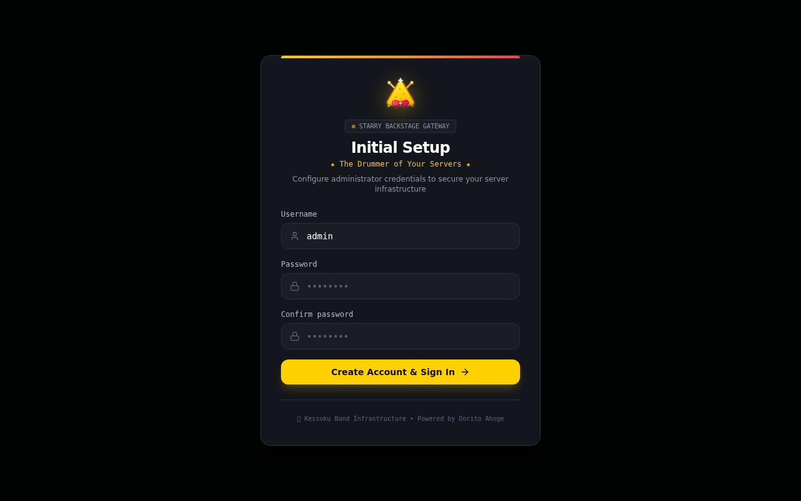
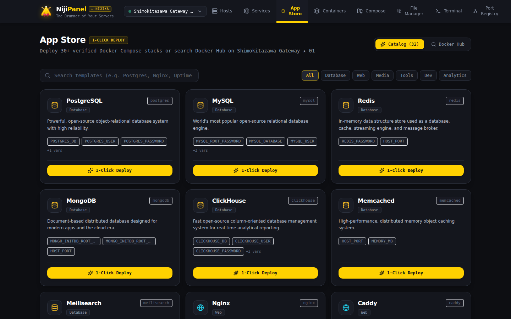
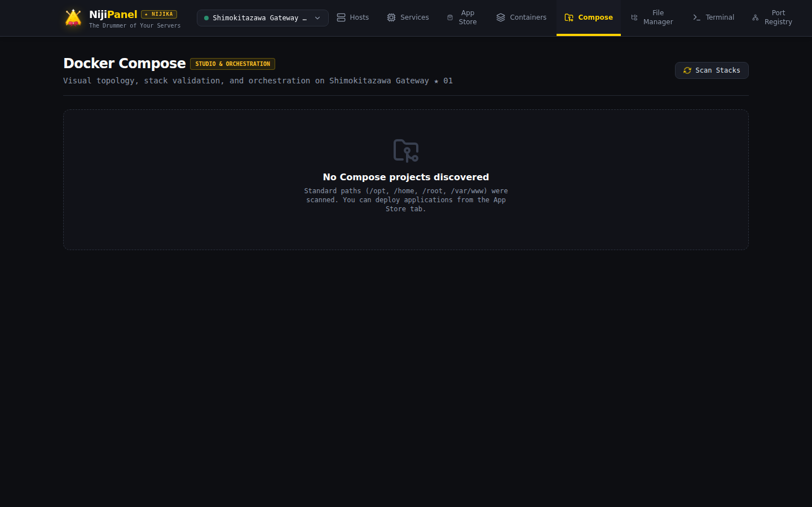

# NijiPanel 🥁✨ (Nijika Edition)

**The Drummer of Your Servers**  
*Быстрая, функциональная и легковесная панель управления серверным флотом на базе .NET 10 и React 19.*

---

## 🌟 Добро пожаловать в документацию NijiPanel!

**NijiPanel** — это современная, автономная веб-панель и командный центр для управления парком Linux-серверов любого масштаба. Проект создан с фокусом на нулевой оверхед, бескомпромиссную безопасность и эстетику ритм-секции Kessoku Band: фирменный темно-угольный фон **IBM Carbon Dark** (`#0d0e12`), акцентный золотистый цвет **Dorito Yellow** (`#ffd100`), строгие прямоугольные формы без скруглений (`0px border-radius`) и полное отсутствие сторонних агентов на целевых хостах.

---

## 🎯 Ключевые преимущества

| Особенность | Описание |
| :--- | :--- |
| **Agentless Архитектура** | Полное отсутствие фоновых демонов, агентов или бинарников на управляемых серверах. Все взаимодействие идет исключительно по нативному SSH (SFTP, PTY, ShellStream). |
| **Все в одном бинарнике/контейнере** | Бэкенд на **.NET 10 Web API** и фронтенд на **React 19 SPA** скомпилированы в единый легковесный образ Docker или автономный исполняемый файл. |
| **IBM Carbon x Nijika Theme** | Строгий индустриальный дизайн IBM Carbon Design System, острые углы `0px`, палитра Dorito Yellow (`#ffd100`), темная тема `#0d0e12`, `#282828`. |
| **Экосистема Docker & Compose** | Инспекция контейнеров, Crash Watchdog, детектор OOM-Killed (Exit 137), Smart Prune с предпросмотром, Docker Exec терминал и визуальный редактор Compose Studio. |
| **1-Click App Store (30+ шаблонов)** | Мгновенный деплой PostgreSQL, Redis, Nextcloud, Vaultwarden, Uptime Kuma, Plausible, Gitea, Grafana и других сервисов с подстановкой переменных и поиском в Docker Hub. |
| **Неубиваемый Web-терминал** | Многовкладочный SSH-терминал на базе ShellStream и WebSocket с 256 КБ кольцевым буфером. Сессии удерживаются в памяти бэкенда и не сбрасываются при закрытии вкладки или потере связи. |
| **SFTP File Manager + Monaco Diff** | Полноценный файловый менеджер с Monaco Editor, Diff Viewer перед сохранением, визуализатором Treemap, архивацией (.zip/.tar.gz) и временными ссылками на скачивание. |
| **Полный SysAdmin Cockpit** | Управление службами Systemd и логами journalctl, учетными записями Linux (/etc/passwd, sudo), обновлениями пакетов (APT/DNF/Pacman/APK), правилами UFW и Fail2ban. |
| **Безопасность корпоративного уровня** | Аппаратные Passkeys (WebAuthn/FIDO2), шифрование учетных данных AES-256-GCM, PBKDF2 хеширование паролей, рандомизация SSH-портов (20000–59000). |
| **Централизованный commands.json** | Все системные bash-команды вынесены в настраиваемый реестр с возможностью редактирования из панели без перекомпиляции бэкенда. |
| **Deep URL Routing & Кэширование** | Каждая вкладка и состояние хоста доступны по прямой ссылке (`/docker?host=...`), а двухуровневое кэширование защищает хосты от thundering herd. |

---

## 📸 Галерея интерфейса

### Онбординг и первоначальная настройка
Мастер первого запуска позволяет сгенерировать 4096-битный мастер-ключ, добавить первый хост и развернуть рекомендованный базовый стек за 4 простых шага.

### Каталог приложений 1-Click App Store
Готовые проверенные production-ready шаблоны с готовыми томами, портами и безопасными паролями.

### Визуальный редактор Docker Compose Studio
Редактирование compose-файлов в редакторе Monaco со встроенной проверкой конфигурации `docker compose config --dry-run` и интерактивным деревом сервисов.

### Системный монитор Systemd Cockpit & Journalctl
Инспекция активных, упавших и отключенных служб Linux с просмотром журнала системных сообщений в реальном времени.

### SFTP Файловый менеджер & Monaco Diff Viewer
Двухоконный редактор файлов с отображением разницы изменений перед записью на удаленный сервер.

### Безопасность и аппаратные ключи Passkeys
Вход в панель без паролей с помощью Touch ID, Face ID, Windows Hello или аппаратных токенов YubiKey по стандарту FIDO2 / WebAuthn.

---

## 🗺️ Структура документации

1. [🚀 Быстрый старт & Установка](quickstart.md) — запуск в Docker Compose, бинарниках, мастер первого запуска.
2. [🏗️ Архитектура платформы](architecture.md) — .NET 10, React 19, Renci.SshNet, PTY/ShellStream, кэширование и маршрутизация.
3. [🎨 Дизайн-система IBM Carbon & Nijika Theme](design-system.md) — дизайн-токены, шрифты, правила 0px.
4. [🖥️ Fleet Overview & Мониторинг](fleet.md) — карточки хостов, sparkline-графики, предсказатель заполнения диска.
5. [🐳 Docker Containers & Stacks](docker.md) — мониторинг контейнеров, OOM-Killed, Smart Prune, Docker Exec, Compose Studio.
6. [📦 1-Click App Store](app-store.md) — 32 готовых шаблона, поиск образов Docker Hub.
7. [💻 SSH Терминал & Persistent сессии](terminal.md) — отказоустойчивые PTY-вкладки, буфер обмена, отслеживание CWD.
8. [📂 File Manager & SFTP](file-manager.md) — SFTP, Monaco Editor, Treemap, архивация, шаринг файлов по ссылкам.
9. [⚙️ Systemd Cockpit](systemd.md) — управление демонами Linux, journalctl логи, фильтрация.
10. [👥 Linux Users & Groups](users.md) — учетные записи Linux, sudo права, блокировка доступа.
11. [📦 Обновления пакетов ОС](packages.md) — проверка безопасности и апгрейд пакетов APT/DNF/Pacman/APK.
12. [🌐 Порты, туннели & Live Sockets](network.md) — сокеты `ss -tulpn`, туннели SSH, порт-форвардинг.
13. [🔒 Безопасность, Firewall & Fail2ban](security.md) — Passkeys, AES-256, рандомизация SSH, UFW, Fail2ban.
14. [⏰ Cron Scheduler](cron.md) — планировщик crontab, валидация расписания, тестовый запуск.
15. [📊 Аппаратный бенчмарк](benchmarking.md) — CPU SHA256, Disk Direct I/O, Ping, расчет Health Score.
16. [⚙️ Реестр команд (commands.json)](commands-registry.md) — 56 системных bash-команд, инлайн-редактор.
17. [📖 Полный REST API Reference](api.md) — спецификация всех REST эндпоинтов, DTO и cURL примеры.
18. [📝 Правила обновления документации](CONTRIBUTING_DOCS.md) — строгий регламент синхронизации кода и вики.
