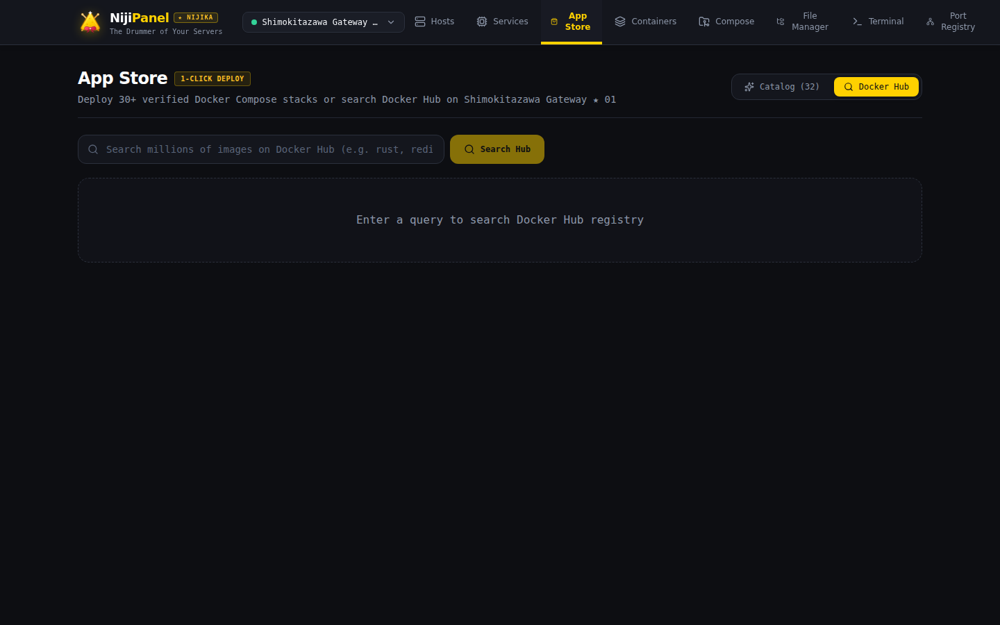

# 📦 1-Click App Store & Docker Hub

Каталог приложений **App Store** в NijiPanel позволяет разворачивать популярные серверные сервисы, базы данных и инструменты в один клик без необходимости вручную писать файлы `docker-compose.yml`.

---

## 🏬 1. Каталог готовых шаблонов (32 приложения)

Все шаблоны проверены на совместимость, содержат оптимальные настройки перезапуска (`restart: unless-stopped`), изолированные тома данных и безопасные предустановленные переменные окружения.

Каталог разбит на 6 категорий:

### 🗄️ Базы данных (Database)
* **PostgreSQL (16-alpine):** мощная реляционная СУБД с поддержкой сложных запросов и JSONB.
* **MySQL (8.4 LTS):** популярная реляционная база данных для веб-приложений.
* **Redis (7-alpine):** сверхбыстрое in-memory хранилище данных, кэш и брокер сообщений.
* **MongoDB (7.0):** масштабируемая документоориентированная NoSQL база данных.
* **ClickHouse:** колоночная аналитическая СУБД для работы с большими данными в реальном времени.
* **Memcached (alpine):** распределенная система кэширования объектов в оперативной памяти.
* **Meilisearch:** молниеносный поисковый движок с поддержкой опечаток и фасетов.

### 🌐 Веб-сервисы и CMS (Web)
* **Nginx (alpine):** высокопроизводительный HTTP-сервер и обратный прокси.
* **Caddy:** современный веб-сервер с автоматическим выпуском сертификатов Let's Encrypt SSL/TLS.
* **WordPress:** самая популярная в мире система управления контентом и блогами.
* **Ghost:** профессиональная платформа для современных изданий, рассылок и блогов.
* **Directus:** универсальный headless-бэкенд и админ-панель над вашей SQL-базой данных.
* **Nextcloud:** персональное защищенное облачное хранилище файлов, контактов и календарей.

### 🛠️ Инструменты и утилиты (Tools)
* **Vaultwarden:** легковесный совместимый сервер Bitwarden на Rust для безопасного хранения паролей.
* **Uptime Kuma:** мониторинг доступности серверов, сайтов и портов с красивыми публичными страницами статуса.
* **Portainer CE:** классическая веб-панель управления контейнерами.
* **n8n:** платформа автоматизации рабочих процессов и интеграций (workflow automation).
* **MinIO:** высокопроизводительное S3-совместимое объектное хранилище.
* **RabbitMQ:** масштабируемый брокер сообщений с веб-интерфейсом управления.
* **Vikunja:** персональный и командный планировщик задач и To-Do списков.
* **Home Assistant:** центр управления умным домом и IoT-устройствами.
* **Pi-hole:** сетевой блокировщик рекламы и локальный DNS-сервер.
* **Stirling-PDF:** мощный веб-набор инструментов для редактирования, сжатия и конвертации PDF-файлов.

### 💻 Инструменты разработчика (Dev)
* **Gitea:** легковесный self-hosted Git-сервис с тикетами, пулл-реквестами и CI/CD runners.
* **Penpot:** открытая альтернатива Figma для дизайнеров интерфейсов и разработчиков.
* **Adminer:** однофайловый веб-клиент для управления базами данных MySQL, Postgres, SQLite.

### 📊 Аналитика и мониторинг (Analytics)
* **Grafana:** индустриальный стандарт визуализации метрик, логов и построения дашбордов.
* **Prometheus:** база данных временных рядов для мониторинга серверов и приложений.
* **Plausible Analytics:** легковесная, приватная веб-аналитика без использования cookies.

### 🎬 Медиа и загрузки (Media)
* **Jellyfin:** свободный медиасервер для организации домашней коллекции фильмов, сериалов и музыки.
* **Transmission:** быстрый и легковесный BitTorrent клиент с веб-интерфейсом.
* **qBittorrent:** продвинутый торрент-клиент с поисковым движком и гибкими правилами ограничения скорости.

---

## 🚀 2. Развертывание приложения

При клике на карточку приложения открывается модальное окно кастомизации:

1. **Выбор хоста назначения:** выбор любого сервера из вашего подключенного флота.
2. **Настройка переменных окружения:**
   * Изменение номеров портов хоста (например, замена дефолтного порта `5432` на `5433` для избежания конфликта).
   * Задание собственных паролей или автоматическая генерация случайных криптографических паролей.
   * Настройка названий баз данных и логинов.
3. **Целевая директория:**  
   По умолчанию стек разворачивается в директорию `/opt/stacks/<имя-шаблона>` на удаленном сервере.
4. **Автоматический запуск:**  
   NijiPanel создает каталог, записывает файл `docker-compose.yml`, подставляет переменные и выполняет `docker compose up -d`. Статус готовности отображается в окне логов.

---

## 🔎 3. Встроенный поиск в Docker Hub

Если нужного приложения нет среди стандартных шаблонов, в правом верхнем углу доступен поиск по официальному каталогу **Docker Hub**:

* **Мгновенный поиск:** вывод результатов по ключевым словам.
* **Информация об образе:** бейдж официального репозитория (`OFFICIAL`), количество звезд ⭐ и краткое описание.
* **Генерация команды запуска:** возможность скопировать готовую команду `docker run` или открыть терминал хоста для быстрой загрузки.
