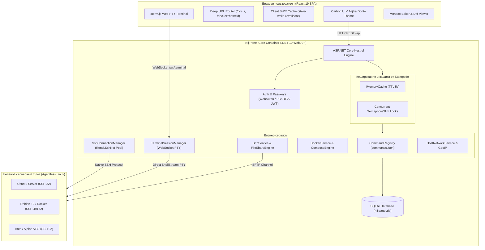

# 🏗️ Архитектура платформы

NijiPanel спроектирована как высокопроизводительная, легковесная и полностью автономная платформа. В ее основе лежит агентless-принцип: целевые хосты не захламляются бинарниками, а панель работает быстро, предсказуемо и потребляет минимум ресурсов.

---

## 🏛️ Общая архитектурная схема



---

## ⚙️ 1. Технологический стек

### Бэкенд:
* **.NET 10.0 Web API:** Максимальная производительность среды выполнения Kestrel, минимальный расход памяти (~60 МБ), поддержка AOT-компиляции и встроенных single-file бандлов.
* **Renci.SshNet:** Асинхронная библиотека протокола SSH2, ShellStream, SFTP и PTY-туннелирования на C#.
* **Entity Framework Core + SQLite:** Автоматическое создание схемы базы данных, легкое резервное копирование копированием одного файла `nijipanel.db`.
* **Fido2-Net-Lib:** Реализация спецификации WebAuthn / FIDO2 для биометрического входа без пароля.

### Фронтенд:
* **React 19 + TypeScript:** Современная компонентная архитектура с мгновенной отрисовкой.
* **Vite:** Сверхбыстрая сборка и разбиение на чанки (`vendor-react`, `vendor-monaco`, `vendor-terminal`, `vendor-icons`).
* **TailwindCSS:** Реализация строгих дизайн-токенов IBM Carbon Design System с нулевым скруглением углов.
* **@xterm/xterm 5.5:** Полнофункциональный эмулятор терминала ANSI/VT100 с поддержкой цветов 24-bit TrueColor, буфера прокрутки и ресайза колонок.
* **@monaco-editor/react:** Редактор кода от VS Code со встроенной поддержкой Diff Viewer (сравнение изменений) и подсветкой синтаксиса YAML, JSON, Bash, Conf, Dockerfile.
* **Lucide React:** Строгие минималистичные векторные иконки.

---

## 🔌 2. Agentless SSH Engine

В отличие от традиционных панелей управления (Portainer Agent, Netdata, Cockpit-ws на каждом хосте), NijiPanel **не требует установки ни единой программы** на целевые серверы.

1. **Пул соединений (`SshConnectionManager`):**
   * Соединения к хостам кэшируются в потокобезопасном пуле `ConcurrentDictionary<string, SshClient>`.
   * При разрыве соединения механизм автоматически переподключается с экспоненциальной задержкой.
2. **SFTP-клиенты (`SftpClient`):**
   * Отдельные долгоживущие SFTP-сессии для высокоскоростной передачи файлов, чтения директорий и стриминга содержимого без вызова bash-утилит.
3. **Безопасность учетных данных:**
   * Все SSH-пароли и приватные ключи хранятся в базе данных SQLite в зашифрованном виде с использованием алгоритма **AES-256-GCM** (96-битный случайный nonce, 128-битный аутентификационный тег GCM).
   * Ключ шифрования привязан к локальному мастер-секрету сервера.

---

## 💻 3. SSH Terminal & Persistent Backend PTY сессии

Модуль терминала построен на модели прямого WebSocket PTY и персистентного менеджера сессий `TerminalSessionManager` в .NET 10:

* **Живучесть сессий на бэкенде (Agentless Persistence):**  
  При открытии вкладки бэкенд создает и удерживает открытый `ShellStream` напрямую в памяти. Если у пользователя оборвется интернет, перезагрузится браузер или закроется вкладка — **процессы на сервере не прерываются**, а вывод продолжает поступать в буфер сессии. При повторном открытии вкладки терминал мгновенно ре-аттачится к активному каналу.
* **Бинарный протокол Zero-Allocation:**  
  Пакеты передаются через `WebSocketMessageType.Binary` с префиксами `0x00` (данные), `0x01` (ресайз) и `0x02` (скроллбэк), исключая оверхед JSON-сериализации.
* **Кольцевой буфер скроллбэка (256 КБ):**  
  На стороне бэкенда ведется кольцевой буфер чанков вывода. При подключении нового WebSocket-клиента история экрана мгновенно передается в `xterm.js` как `Uint8Array`, исключая разрыв многобайтовых символов UTF-8.
* **Отслеживание реального CWD (Current Working Directory):**  
  NijiPanel считывает текущий каталог из заголовка окна оболочки / последовательностей OSC 7 на клиенте, не создавая паразитной нагрузки на SSH.
* **Буфер обмена и Bracketed Paste:**  
  Поддержка безопасной вставки больших многострочных скриптов без риска случайного преждевременного выполнения строк.

---

## 🛡️ 4. Двухуровневое кеширование и защита от Thundering Herd (Stampede)

Панель мониторинга периодически запрашивает телеметрию серверов (CPU, память, диски, сеть, процессы). Чтобы исключить перегрузку удаленных машин и SSH-демонов частыми запросами при открытии нескольких вкладок или параллельных пользователей, реализована двухуровневая система:

### Серверный уровень (`ICacheService`):
```csharp
public async Task<T> GetOrCreateAsync<T>(string key, Func<Task<T>> factory, TimeSpan? ttl = null)
{
    // 1. Быстрый путь: значение уже в памяти
    if (_memoryCache.TryGetValue(key, out T? cachedValue) && cachedValue != null)
        return cachedValue;

    // 2. Медленный путь с единичным выполнением задачи на ключ
    var lazyTask = _inFlightTasks.GetOrAdd(key, k => new Lazy<Task<object?>>(async () =>
    {
        if (_memoryCache.TryGetValue(k, out T? existing) && existing != null)
            return (object?)existing;

        var value = await factory();
        if (value != null) Set(k, value, ttl);
        return (object?)value;
    }));

    try
    {
        var result = await lazyTask.Value;
        return (T)result!;
    }
    finally
    {
        _inFlightTasks.TryRemove(new KeyValuePair<string, Lazy<Task<object?>>>(key, lazyTask));
    }
}
```
* **Защита от stampede / thundering herd:** Даже если 20 запросов придут на сбор метрик одного хоста в одну и ту же миллисекунду, физическая SSH-команда на сервер уйдет ровно **один раз**, а остальные 19 запросов дождутся ее завершения на `SemaphoreSlim` и получат общий результат.
* **TTL метрик:** 5 секунд для активной телеметрии.
* **Префиксная инвалидация:** При любом изменении хоста (редактирование, удаление, добавление правила файрвола, перезапуск контейнера) вызывается `InvalidateHost(hostId)`, мгновенно сбрасывая закэшированные срезы `host_stats_*`, `docker_*`, `systemd_*` и т.д.

### Клиентский уровень (Stale-While-Revalidate):
* На фронтенде данные хостов сохраняются в глобальных модульных картах `cachedStatsMap` и `cachedMetricsMap`.
* При переключении между вкладками или повторном открытии раздела карточки хостов и sparkline-графики отображаются **мгновенно** из памяти без задержек и спиннеров.
* В фоне асинхронно отправляется запрос на обновление, который мягко обновляет UI при получении новых данных.

---

## 🔗 5. URL роутинг страниц и глубокие ссылки

NijiPanel поддерживает глубокую навигацию с сохранением состояния через стандартный браузерный стек History API (`pushState` / `replaceState` / `popstate`):

### Структура URL-маршрутов:
* `/hosts` — главный дашборд флота серверов
* `/docker?host=<hostId>` — управление Docker-контейнерами выбранного хоста
* `/compose?host=<hostId>` — редактор Docker Compose Studio
* `/appstore?host=<hostId>` — магазин приложений 1-Click
* `/terminal?host=<hostId>` — полноэкранный SSH-терминал с открытыми вкладками
* `/files?host=<hostId>&path=/var/log` — SFTP проводник с переходом в конкретную директорию
* `/services?host=<hostId>` — монитор служб Systemd и journalctl
* `/cron?host=<hostId>` — задачи планировщика crontab
* `/ports?host=<hostId>` — открытые порты, туннели и сокеты
* `/firewall?host=<hostId>` — правила UFW и изоляция Fail2ban
* `/utils` — генераторы паролей, SSH-ключей и скрипты инициализации
* `?modal=settings` — модальное окно настроек платформы

### Преимущества:
1. **Прямые ссылки:** Вы можете отправить коллеге ссылку вида `http://panel.lan/files?host=db-prod&path=/etc/postgresql/16/main` или сохранить ее в закладки.
2. **Сохранение контекста:** При переключении разделов активный выбранный хост (`hostId`) автоматически переносится в новый раздел.
3. **Навигация назад/вперед:** Кнопки браузера «Назад» и «Вперед» работают естественно без перезагрузки всей страницы.

---

## 🗄️ 6. База данных SQLite & Схема данных

База данных NijiPanel не требует отдельного сервиса PostgreSQL или MySQL и хранится в одном компактном файле `nijipanel.db`.

### Основные сущности:
* **`AdminUsers`** — учетная запись администратора, хэш пароля PBKDF2, соль, дата создания.
* **`PasskeyCredentials`** — зарегистрированные аппаратные WebAuthn ключи (CredentialId, PublicKey, SignCount, AAGUID).
* **`Hosts`** — конфигурация серверов: имя, IP, порт, пользователь, тип аутентификации, зашифрованные учетные данные AES-256-GCM.
* **`HostPorts`** — каталог используемых портов хоста с заметками и именами сервисов.
* **`HostNotes`** — markdown-заметки к серверу.
* **`SshTunnels`** — зарегистрированные локальные и удаленные туннели SSH.
* **`MetricsHistory`** — кольцевая история метрик CPU, памяти и сети для sparkline-графиков.
* **`Notifications`** — журнал системных алертов и уведомлений.
* **`CommandTemplates`** — таблица системных команд с возможностью пользовательской модификации.
* **`SharedFiles`** — временные публичные ссылки для скачивания файлов с серверов (токены, TTL, лимиты, хэши паролей).

---

## ⚙️ 7. Реестр команд (`commands.json`)

Все команды, выполняемые NijiPanel на Linux-хостах, полностью вынесены из исходного C#-кода во внешний декларативный реестр `commands.json`. 

При старте бэкенда команды загружаются в таблицу `command_templates` SQLite. Системные администраторы могут адаптировать синтаксис под нестандартные дистрибутивы (BusyBox, Alpine, custom kernels) прямо через интерфейс панели без перекомпиляции программы.

Подробнее читайте в разделе [Реестр команд (commands.json)](commands-registry.md).
