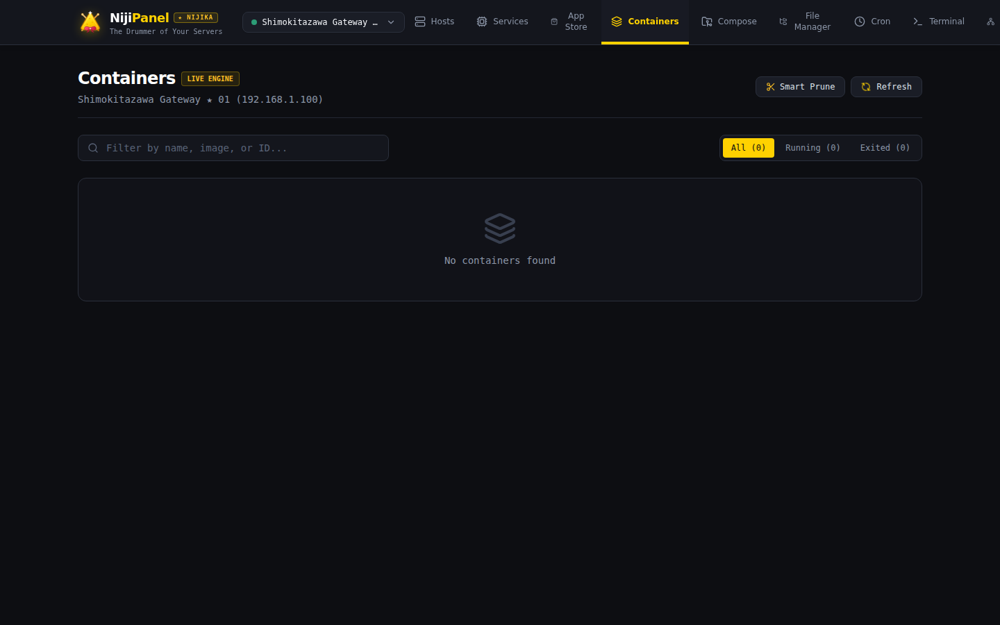
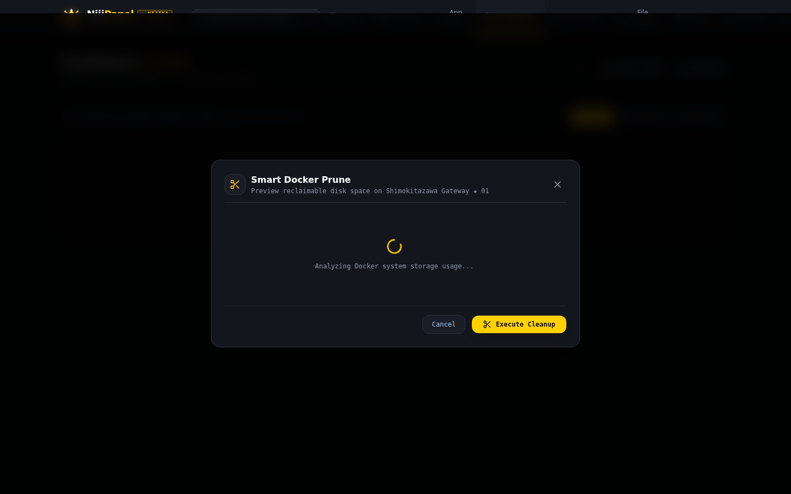

# 🐳 Docker Containers & Stacks

Модуль управления Docker в NijiPanel превращает любой Linux-сервер с установленным Docker Engine в полноценную контейнерную платформу без необходимости развертывать тяжелые сторонние панели вроде Portainer.

---

## 📦 1. Управление контейнерами (Container Lifecycle)

Интерфейс раздела **Containers** отображает полный список контейнеров хоста со всеми ключевыми параметрами:

* **Идентификатор и имя:** уникальный Short ID и понятное имя контейнера.
* **Используемый образ (Image):** тег, digest и версия базового образа.
* **Статус и аптайм:** `running` (зеленый), `exited` (рубиновый), `paused` (желтый), `restarting`.
* **Маппинг портов:** наглядный список проброшенных портов хоста и контейнера (например, `0.0.0.0:8080->80/tcp`).
* **Кнопки быстрого управления:**
  * ▶️ **Start** — запуск остановленного контейнера.
  * ⏹️ **Stop** — корректная остановка по сигналу SIGTERM (с таймаутом).
  * 🔄 **Restart** — перезапуск контейнера.
  * ⏸️ **Pause / Unpause** — временная заморозка процессов контейнера через cgroups freezer.
  * ⚡ **Kill** — немедленное завершение по сигналу SIGKILL.
  * 🗑️ **Remove** — удаление контейнера (с опцией принудительного удаления `force`).

---

## 💥 2. Детектор OOM-Killed & Crash Watchdog

Падение контейнера из-за нехватки памяти (Out-Of-Memory) часто остается незамеченным обычными мониторингами, так как контейнер просто перезапускается или переходит в статус Exited.

NijiPanel включает специализированный сторожевой таймер **Crash Watchdog**:
* **Пакетная инспекция состояний (`Docker.InspectStateBatch`):**  
  Панель считывает статус завершения контейнеров через `docker inspect --format '{{.State.ExitCode}} {{.State.OOMKilled}}'`.
* **Оповещение об OOM (ExitCode 137):**  
  Если контейнер был принудительно убит ядром Linux из-за превышения лимитов памяти, NijiPanel выставляет яркий бейдж `[OOM-KILLED]`.
* **Краш-дамп и криминалистика (Crash Dump Forensics):**  
  Клик по бейджу открывает модальное окно с деталями аварии:
  * Точное время падения (`FinishedAt`).
  * Код завершения (`ExitCode`) и текст ошибки ядра (`Error`).
  * Последние 100 строк логов stdout/stderr непосредственно перед падением контейнера.

---

## 🧹 3. Очистка диска Smart Docker Prune

Со временем Docker накапливает десятки гигабайт неиспользуемых анонимных слоев, старых образов и сборочного кэша. Обычная команда `docker system prune` выполняется «вслепую».

В NijiPanel реализован безопасный диалог **Smart Prune с предварительным расчетом**:

1. **Предварительный просмотр (Dry-Run Preview):**  
   Панель опрашивает демон Docker и вычисляет точный объем дискового пространства, который будет освобожден:
   * Неиспользуемые образы (Dangling & Unused Images)
   * Остановленные контейнеры (Stopped Containers)
   * Кэш сборки BuildKit (Builder Cache)
   * Бесхозные тома (Dangling Volumes — с отдельным флагом подтверждения)
2. **Селективное удаление:**  
   Администратор может отметить галочками только нужные категории для очистки.
3. **Отчет об освобожденном месте:**  
   После выполнения операции выводится точное количество освобожденных мегабайт/гигабайт.

---

## 💻 4. Встроенный Docker Exec Web Terminal

Для быстрой отладки контейнера не требуется подключаться по SSH к хосту и вручную искать ID контейнера:

* Кнопка **Terminal** на карточке любого запущенного контейнера открывает встроенный терминал xterm.js прямо внутри контейнера.
* Поддержка оболочек: автоматический выбор `/bin/bash`, `/bin/sh` или `/bin/ash` (для легковесных контейнеров на базе Alpine).
* Интерактивная работа: поддержка nano, vi, curl, psql, redis-cli и других консольных утилит в реальном времени.

---

## 🧩 5. Docker Compose Visual Studio

Раздел **Compose** представляет собой визуальную студию для оркестрации многоконтейнерных стеков:

* **Автоматическое обнаружение стеков:**  
  NijiPanel сканирует хост на наличие файлов `docker-compose.yml` в стандартных путях (`/opt`, `/etc/docker/compose`, `/home/*`, директории проектов) или позволяет указать произвольный путь.
* **Редактор Monaco со встроенной подсветкой:**  
  Полнофункциональный редактор кода с автодополнением и подсветкой синтаксиса YAML.
* **Интерактивная карта связей (Visual Graph):**  
  Панель парсит структуру compose-файла и строит наглядный граф:
  * Сервисы и их зависимости (`depends_on`).
  * Внутренние и внешние сети (`networks`).
  * Тома данных (`volumes`).
  * Экспонированные порты.
* **Валидация конфигурации перед деплоем:**  
  Кнопка **«Validate»** запускает проверку через `docker compose config --dry-run` на стороне хоста. Если в YAML допущена ошибка синтаксиса или неверно указана переменная, панель подсветит точную строку и текст ошибки до перезапуска сервисов.
* **Управление жизненным циклом стека:**  
  Команды `docker compose up -d`, `down`, `restart`, `pull` и живой просмотр агрегированных логов всех сервисов стека с автоскроллом.
