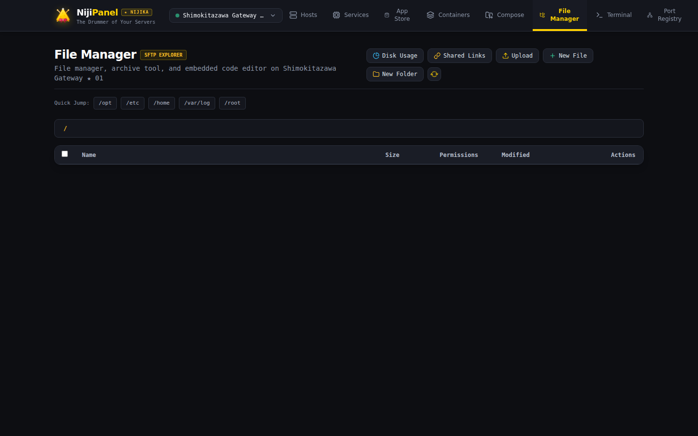

# 📂 File Manager & SFTP Хранилище

Файловый менеджер NijiPanel сочетает в себе скорость протокола SFTP, мощь редактора кода Monaco Editor и продвинутые инструменты анализа дискового пространства.



---

## 🧭 1. Навигация по файловой системе (SFTP Explorer)

* **Быстрая навигация:** хлебные крошки (Breadcrumbs) с возможностью перехода в любой родительский каталог в 1 клик.
* **Атрибуты файлов:** отображение точного размера, времени последней модификации, владельца (`uid/gid`) и Unix-прав доступа (`rwxr-xr-x` / `0755`).
* **Базовые операции:** создание новых файлов и папок, переименование, удаление, скачивание и загрузка файлов с компьютера через Drag-and-Drop.
* **Быстрый переход:** удобный ввод произвольного абсолютного пути в строку адреса (например, `/var/log` или `/etc/nginx/sites-available`).

---

## 📝 2. Monaco Editor & Встроенный Diff Viewer

Для редактирования конфигурационных файлов, скриптов автоматизации и документов в панель встроен редактор **Monaco** (ядро VS Code):

* **Подсветка синтаксиса:** автоопределение синтаксиса по расширению файла (JSON, YAML, Bash, Dockerfile, Nginx config, Python, INI, XML, Markdown).
* **Инспектор изменений (Monaco Diff Viewer):**  
  Перед сохранением файла вы можете переключиться в режим **Diff**:
  * В левой панели отображается исходная версия файла с сервера.
  * В правой — ваша измененная версия.
  * Все добавленные, удаленные и измененные строки подсвечиваются зеленым и красным цветом.
  * Исключает случайное удаление важных строк конфигурации.
* **Горячие клавиши:** сохранение по нажатию `Ctrl + S` (`Cmd + S` на macOS).

---

## 🗺️ 3. Smart Disk Usage Treemap

Поиск файлов и папок, «съевших» все дисковое пространство, превращается в наглядный процесс:

* **Интерактивная диаграмма:** отображение распределения занятого пространства в виде пропорциональных прямоугольников (Treemap).
* **Исключение псевдофайловых систем:**  
  Чтобы сканирование не зависало на виртуальных директориях ядра, по умолчанию автоматически исключаются системные точки монтирования:
  ```
  /proc, /sys, /mnt, /dev, /run
  ```
* **Настройка глубины сканирования:** выбор глубины рекурсии (`depth=1`, `depth=2`) для баланса между детализацией и скоростью сканирования на дисках с миллионами файлов.

---

## 🗜️ 4. Серверная архивация и распаковка (In-Place Archiving)

Архивация файлов выполняется непосредственно мощностями удаленного сервера без необходимости предварительно выкачивать гигабайты данных на локальный компьютер:

* **Создание архивов:** выделите галочками один или несколько файлов/каталогов и нажмите **Archive**:
  * Форматы: `.zip` и `.tar.gz`.
  * Выбор имени результирующего архива.
* **Распаковка архивов:** клик по любому архиву `.zip`, `.tar.gz`, `.tgz`, `.tar.bz2` позволяет распаковать его в текущий или указанный каталог прямо на сервере.

---

## 🔗 5. Публичные ссылки на скачивание (File Sharing)

Вам нужно срочно передать коллеге лог-файл, дамп базы данных или конфигурацию без создания учетной записи на сервере? Модуль **File Sharing** решает эту задачу:

* **Генерация уникальной ссылки:** панель создает публичный защищенный URL вида:
  ```
  http://panel.yourdomain.com/d/7f8a9b2c-4e1d-4a9f-8c3b-123456789abc
  ```
* **Срок жизни (TTL):** автоматическое удаление ссылки через 1 час, 6 часов, 24 часа, 7 дней или бессрочно.
* **Лимит скачиваний (Burn-After-Reading):** возможность сделать ссылку строго одноразовой (ссылка аннулируется сразу после 1 успешного скачивания) или ограничить N загрузками.
* **Защита паролем:** опциональная установка пароля; получателю потребуется ввести пароль для доступа к файлу.
* **Безопасность:** файл отдается напрямую потоком через защищенный SFTP-шлюз бэкенда без сохранения промежуточных копий на диске панели.
* **Управление ссылками:** просмотр всех активных ссылок с количеством оставшихся загрузок и кнопкой мгновенного отзыва (Revoke).

---

## 🚀 6. Прямая синхронизация между серверами (Direct Transfer)

При миграции данных между двумя серверами из вашего флота (например, перенос резервной копии с `web-prod` на `backup-node`):

* Выберите исходный сервер и путь к файлу.
* Выберите целевой сервер и директорию назначения.
* NijiPanel инициирует прямое соединение `rsync`/`scp` между двумя машинами по SSH.
* **Трафик не идет через ваш браузер!** Данные передаются на максимальной скорости внутри датацентра или между провайдерами.
