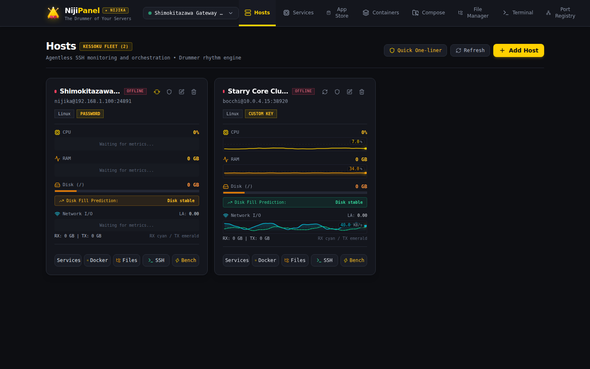
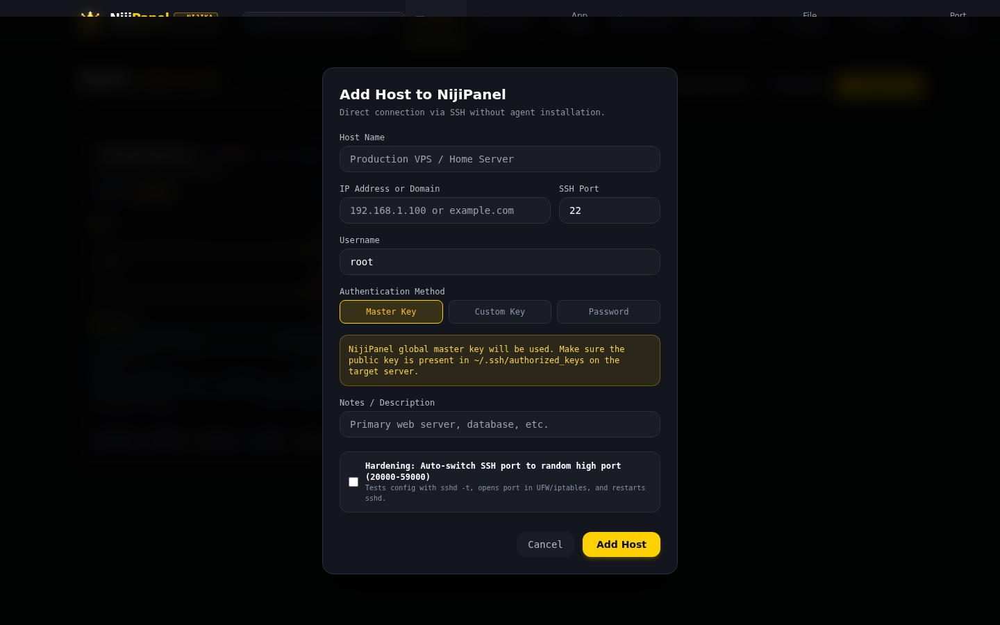

# 🖥️ Fleet Overview & Управление серверами

Раздел **Fleet Overview** — это командный мостик NijiPanel, объединяющий инвентарь всей вашей инфраструктуры, телеметрию в реальном времени, сетевой анализ и управление защитой.



---

## 📊 1. Мониторинг и живые метрики

Для каждого подключенного сервера панель в режиме реального времени отображает:

* **Статус доступности:** зеленый бейдж `ONLINE` или рубиновый `OFFLINE` с указанием ошибки подключения.
* **Название ОС и ядро:** считывание дистрибутива (`/etc/os-release`) и версии ядра Linux (`uname -srm`).
* **Аптайм и Load Average:** текущее время непрерывной работы и средняя нагрузка за 1, 5 и 15 минут (`/proc/loadavg`).
* **Процессор (CPU):** процент утилизации CPU с плавным цветовым градиентом от зеленого к золотистому и рубиновому.
* **Оперативная память (RAM):** точные значения использованной и доступной памяти в ГБ и процентах.
* **Дисковое пространство (Disk):** заполненность корневого раздела `/`, объем в гигабайтах и процент использования.
* **Сетевой трафик (Network I/O):** суммарный объем принятых (RX) и переданных (TX) данных через физические интерфейсы с момента загрузки.
* **Наличие Docker:** версия демона Docker или статус `Not installed`.

---

## 📈 2. Sparkline-графики в стиле Beszel

В каждую карточку сервера встроен компактный векторный sparkline-график, отображающий динамику ключевых параметров:

* **Кольцевая история измерений:** бэкенд сохраняет исторические срезы метрик в таблице `metrics_history` SQLite с настраиваемым окном хранения.
* **Мгновенная отрисовка:** графики рендерятся в SVG без тяжелых сторонних canvas-библиотек.
* **Анимация пульса:** при получении нового среза линия графика плавно сдвигается, отражая актуальную динамику нагрузки.

---

## 🔮 3. Предиктивный прогноз заполнения диска (Disk Fill Prediction)

Одной из самых частых причин аварий на серверах является внезапное исчерпание свободного места на диске (out of disk space), приводящее к сбою баз данных и системных служб.

NijiPanel включает математический алгоритм **Disk Fill Prediction**:
1. Анализирует историческую скорость дельты заполнения корневого раздела за последние сутки и недели.
2. Рассчитывает средний темп прироста данных (ГБ/день).
3. При устойчивом росте выводит предупреждающий индикатор с прогнозом: например,  
   `⚠️ Диск заполнится через 4 дня при текущем темпе записи (+2.4 ГБ/сут)`.
4. Интегрируется с модулем уведомлений для заблаговременной отправки алерта в Telegram.

---

## 🧭 4. Масштабируемое дерево серверов (Resizable Sidebar)

Боковое меню NijiPanel разработано для удобной работы с десятками серверов:

* **Регулировка ширины драг-энд-дропом:** граница панели имеет интерактивный разделитель, позволяющий изменять ширину бокового меню в диапазоне **от 200px до 460px**.
* **Запоминание состояния:** выбранная ширина автоматически сохраняется в `localStorage` браузера.
* **Режим ультра-компактности:** кнопка сворачивания переводит сайдбар в режим иконок (ширина 72px), освобождая максимум пространства под терминал и мониторинг.
* **Поиск и фильтрация хостов:** мгновенная фильтрация по имени, тегу или IP-адресу.

---

## 🌐 5. Инспектор сетевой топологии & GeoIP

Кнопка **«Inspect Network»** на карточке любого сервера открывает детальное модальное окно топологии:

* **Публичный IP и GeoIP данные:**
  * Определение публичного внешнего IP-адреса.
  * Провайдер связи / хостинг (ISP и номер автономной системы ASN).
  * Страна, флаг, город, почтовый индекс и географические координаты.
* **Инспекция интерфейсов (`ip -j addr`):**
  * Полный перечень всех физических и виртуальных интерфейсов (`eth0`, `ens3`, `docker0`, bridges, WireGuard `wg0`, tailscale).
  * MAC-адреса и состояние линка (`UP` / `DOWN`).
* **Калькулятор CIDR подсетей:**
  * Для каждого IP-адреса с маской (например, `192.168.1.15/24` или `10.0.0.5/16`) калькулятор автоматически вычисляет:
    * Сетевой адрес (`Network IP`)
    * Широковещательный адрес (`Broadcast IP`)
    * Сетевую маску (`Subnet Mask`)
    * Точный диапазон доступных адресов хостов (`Host Range Min - Max`)
    * Общее количество доступных адресов в подсети
* **Маршрутизация и DNS:**
  * Отображение таблицы маршрутизации ядра (`ip -j route`) и шлюза по умолчанию (`Default Gateway`).
  * Список сконфигурированных резолверов DNS из `/etc/resolv.conf`.

---

## 🛡️ 6. Рандомизация высокого SSH-порта (Hardening)

Стандартный порт SSH (22) подвергается постоянным атакам ботнетов и перебору паролей (brute-force). Модуль **SSH Port Hardening** автоматизирует перенос демона на случайный высокий порт в один клик:



### Алгоритм безопасной миграции:
1. Генерация случайного порта в диапазоне **20000 – 59000** (или ручной ввод порта администратором).
2. **Pre-flight проверка занятости:** проверка отсутствия конфликтов через `ss -tulpn`.
3. **Резервное копирование:** создание бэкапа конфигурационного файла `/etc/ssh/sshd_config.serverdeck.bak`.
4. **Конфигурирование sshd:** модификация параметра `Port <NEW_PORT>` в `/etc/ssh/sshd_config` или создание изолированного файла `/etc/ssh/sshd_config.d/99-serverdeck-port.conf`.
5. **Тестирование синтаксиса:** запуск `sshd -t`. При обнаружении малейшей синтаксической ошибки операция прерывается с откатом бэкапа, исключая потерю доступа.
6. **Автонастройка файрвола:** если на сервере активен UFW или iptables, NijiPanel автоматически открывает новый порт:
   ```bash
   ufw allow <NEW_PORT>/tcp
   iptables -I INPUT -p tcp --dport <NEW_PORT> -j ACCEPT
   ```
7. **Мягкий перезапуск демона:** `systemctl reload ssh` / `systemctl restart sshd`. Активная сессия управления не разрывается.
8. **Обновление в базе NijiPanel:** порт сервера в локальной базе автоматически обновляется на новое значение.

---

## 📦 7. Резервное копирование и экспорт инфраструктуры

В разделе настроек **Settings -> Backup** доступны инструменты для переноса и сохранения конфигурации:

* **Локальный зашифрованный экспорт:** скачивание зашифрованного файла с мастер-паролем, содержащего все серверы, настройки, пользовательские команды и заметки.
* **Облачный экспорт (Cloud Sharing):** генерация защищенного разового кода для мгновенной миграции флота на другую установку NijiPanel.
* **Импорт:** безопасная загрузка файла с расшифровкой и объединением или перезаписью хостов.
