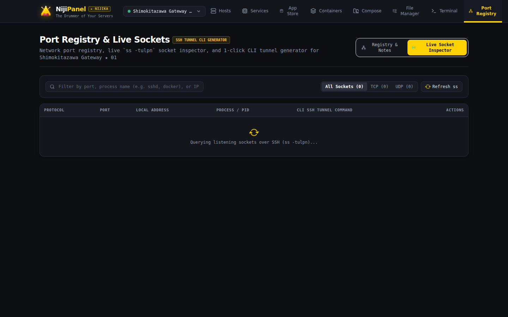
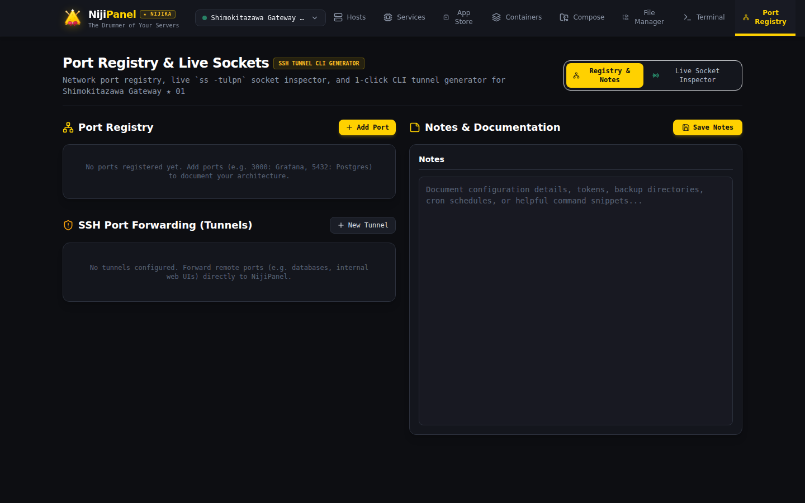

# 🌐 Ports, Tunnels & Live Sockets

Сетевой модуль NijiPanel объединяет инструменты инспекции открытых портов, диагностику сетевых процессов и генератор защищенных SSH-туннелей.



---

## 🔍 1. Инспектор открытых сокетов (`ss -tulpn`)

Вместо устаревшего `netstat`, NijiPanel использует современную быструю утилиту ядра Linux `ss`:

* **Протокол:** `TCP`, `UDP`, `TCP6`, `UDP6`.
* **Локальный адрес и порт:** точный интерфейс привязки (`0.0.0.0:80`, `127.0.0.1:5432`, `[::]:443`).
* **Процесс и PID:** имя бинарника и номер процесса, слушающего порт (например, `nginx (PID: 1420)`, `docker-proxy (PID: 3821)`, `sshd (PID: 812)`).
* **Аудит безопасности:** помогает моментально выявить подозрительные порты, открытые во внешнюю сеть `0.0.0.0` вместо локального `127.0.0.1`.

---

## 📝 2. Реестр портов и заметок (Port Registry)



Для документирования инфраструктуры NijiPanel включает базу данных портов:
* Сохранение сопоставления «Порт ➔ Сервис ➔ Описание».
* Быстрый поиск: кто занимает порт `6379` или `9090`?
* Заметки для команды разработчиков с указанием назначения сервисов.

---

## 🚇 3. Генератор CLI SSH-туннелей

Если сервис запущен на сервере локально (например, Redis на `127.0.0.1:6379` или веб-интерфейс на `localhost:8080`), генератор туннелей создает готовую команду для терминала вашего ноутбука:

### Локальный проброс портов (Local Port Forwarding):
```bash
ssh -L 8080:127.0.0.1:8080 user@server.domain.com -p 22 -N
```
> Позволяет открыть `http://localhost:8080` в браузере вашего компьютера и получить защищенный доступ к сервису удаленного хоста.

### Удаленный реверс-проброс (Remote Reverse Forwarding):
```bash
ssh -R 3000:127.0.0.1:3000 user@server.domain.com -p 22 -N
```
> Позволяет «прокинуть» локальный порт вашего компьютера на удаленный сервер.

### Динамический SOCKS5 прокси (Dynamic Proxy):
```bash
ssh -D 1080 user@server.domain.com -p 22 -N
```
> Превращает SSH-соединение в защищенный персональный VPN/прокси в браузере.

---

## 🔄 4. Фоновые туннели NijiPanel

Бэкенд NijiPanel может самостоятельно поддерживать долгоживущие SSH-туннели между управляемыми машинами для связывания распределенных баз данных или мониторинга внутренних сервисов без открытия публичных портов.
