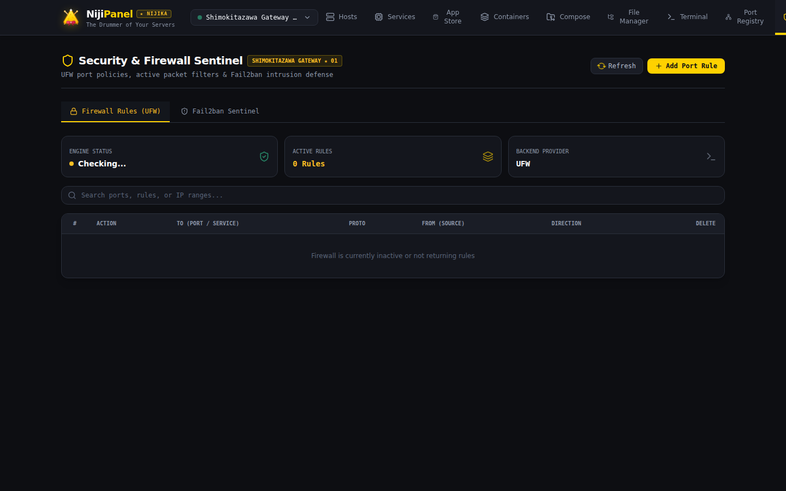
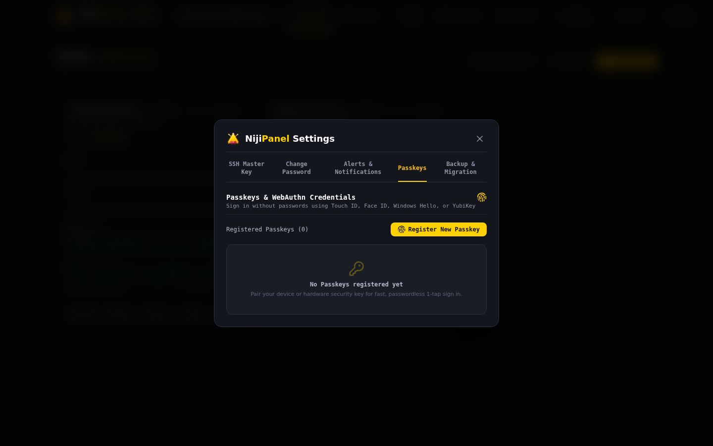
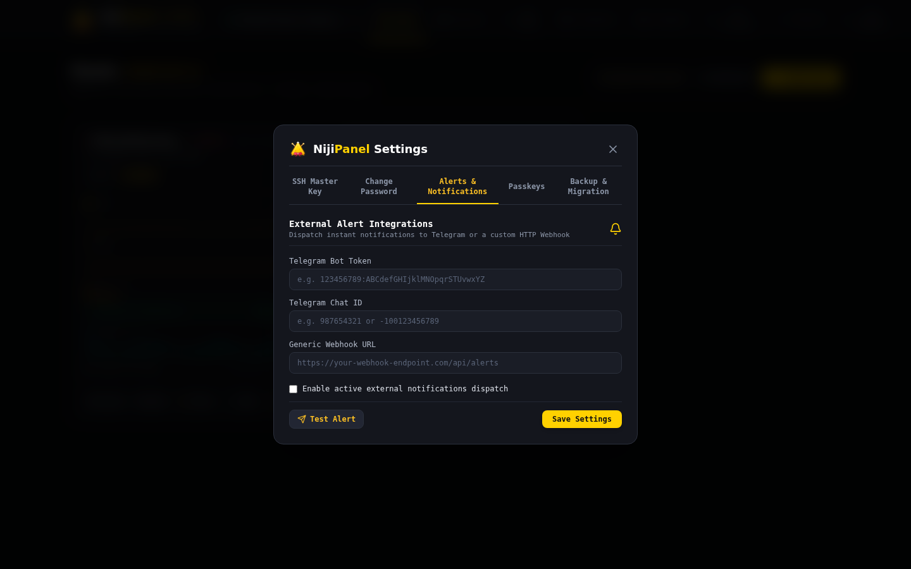

# 🔒 Безопасность, Firewall & Fail2ban

Безопасность является центральным приоритетом NijiPanel. Архитектура платформы разработана с расчетом на работу в открытых и недоверенных сетях.



---

## 🔑 1. Аппаратные ключи Passkeys (WebAuthn / FIDO2)

NijiPanel поддерживает передовой стандарт беспарольной аутентификации **WebAuthn (FIDO2)**:



* **Поддерживаемые аутентификаторы:**
  * **Apple Touch ID & Face ID** на macOS, iOS и iPadOS.
  * **Windows Hello** (распознавание лица, сканер отпечатка, PIN).
  * **Аппаратные USB/NFC ключи:** YubiKey 5 Series, Feitian, Nitrokey, SoloKeys.
  * **Google Titan & Android Screen Lock.**
* **Защита от фишинга:** открытый ключ привязан к конкретному Origin домену (`rpId`), исключая перехват учетных данных через поддельные сайты.
* **Управление ключами:** регистрация нескольких ключей (например, рабочий MacBook + мобильный телефон + запасной YubiKey) с возможностью именования и отзыва.

---

## 🛡️ 2. Шифрование учетных данных хостов (AES-256-GCM)

Все приватные SSH-ключи, пароли и чувствительные параметры серверов зашифрованы в базе данных SQLite:
* **Алгоритм:** симметричное блочное шифрование **AES-256-GCM** (Galois/Counter Mode).
* **Случайный Nonce:** уникальный 96-битный вектор инициализации (IV) генерируется криптографическим генератором `RandomNumberGenerator` для каждого отдельного секрета.
* **Аутентификационный тег (128 бит):** гарантирует целостность зашифрованных данных. Любая попытка модификации файла базы данных приведет к отказу расшифровки и тревоге безопасности.

---

## 👤 3. Защита мастер-пароля администратора (PBKDF2)

* Пароли учетных записей NijiPanel никогда не сохраняются в открытом виде.
* Хэширование выполняется по стандарту **PBKDF2** с функцией **HMAC-SHA256**.
* **100 000 итераций** и 256-битная криптографическая соль делают подбор по радужным таблицам и brute-force на GPU математически нецелесообразными.

---

## 🔔 4. Центр алертов (Telegram & Webhook)

Панель включает модуль непрерывного мониторинга инфраструктурных аномалий:



* **Интеграция с Telegram:** отправка уведомлений через Telegram Bot API прямо в личный чат или группу дежурных инженеров.
* **Пользовательские вебхуки (Generic Webhooks):** отправка JSON-пейлоадов в Discord, Slack, Mattermost, Grafana OnCall или корпоративные SIEM-системы.
* **Триггеры оповещений:**
  * Недоступность сервера (`Host Offline`).
  * Критический перегрев или загрузка CPU > 90% более 5 минут.
  * Заполнение диска > 90% или скорое исчерпание по прогнозу.
  * Обнаружение аварийного завершения контейнера (`OOM-Killed Exit 137`).
* **Кнопка «Test Alert»:** моментальная отправка проверочного сообщения для подтверждения корректности настроек токена и Chat ID.

---

## 🧱 5. Firewall Sentinel (UFW / iptables)

Интерфейс файрвола предоставляет наглядное управление сетевыми экранами:

* **Статус сетевого экрана:** индикация активности `Status: active / inactive`.
* **Таблица правил:**
  * Порядковый номер правила (для точечного удаления).
  * Действие: `ALLOW` (зеленый) или `DENY` (рубиновый).
  * Направление трафика: `IN` (входящий) / `OUT` (исходящий).
  * Протокол: `TCP`, `UDP` или `ANY`.
  * Источник и порт назначения (например, `22/tcp`, `443/tcp`, `192.168.1.0/24`).
* **Добавление правил:** быстрая форма добавления портов или диапазонов IP-адресов.
* **Удаление по индексу:** безопасное удаление правила через `ufw delete <номер>`.

---

## 🚫 6. Fail2ban Sentinel & Разбан IP

Модуль Fail2ban защищает хосты от ботнет-атак и попыток подбора паролей:

* **Мониторинг активных изоляторов (Jails):** сканирование `sshd`, `recidive`, `nginx-http-auth` и других активных зон.
* **Список заблокированных IP:** отображение IP-адресов злоумышленников, даты блокировки и количества неудачных попыток входа.
* **Разбан в 1 клик (Unban IP):** если системный администратор или клиент случайно ввел неверный пароль и был заблокирован, кнопка **Unban** мгновенно снимает блокировку командой:
  ```bash
  fail2ban-client set <jail> unbanip <ip>
  ```
