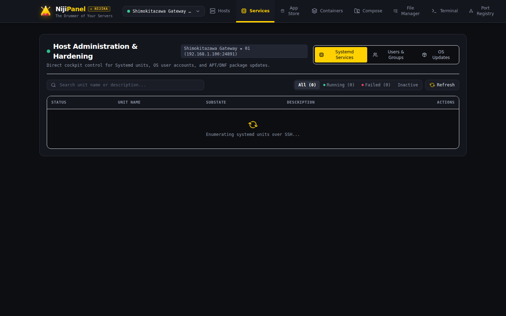

# ⚙️ Systemd Cockpit

Раздел **Services** в NijiPanel предоставляет полный контроль над фоновыми системными службами (Systemd Daemons) Linux-сервера без необходимости ручного ввода команд в консоли.

---

## 📋 1. Инвентаризация системных служб

Панель автоматически считывает состояние системного менеджера `systemd` и выводит подробную таблицу служб:

* **Имя юнита (Unit Name):** например, `nginx.service`, `docker.service`, `ssh.service`, `postgresql.service`.
* **Описание (Description):** понятное человекочитаемое описание назначения службы.
* **Состояние загрузки (Load State):** `loaded` / `not-found`.
* **Активное состояние (Active State):**
  * 🟢 `active (running)` — служба успешно работает.
  * 🔴 `failed` — служба упала или завершилась с ошибкой.
  * ⚪ `inactive (dead)` — служба остановлена.
* **Автозапуск при загрузке (Unit File State):** `enabled` (включен в автозапуск) или `disabled`.

---

## 🔍 2. Фильтрация и поиск служб

Для быстрого поиска проблемных служб предусмотрены фильтры быстрого доступа:
* **All Services:** полный список всех обнаруженных служб.
* **Running:** только активные в данный момент процессы.
* **Failed Services (Критично!):** мгновенный фильтр всех упавших служб, требующих внимания администратора.
* **Поисковая строка:** фильтрация по подстроке в имени юнита или описании (например, ввести `sql` для поиска баз данных).

---

## ⚡ 3. Управление службами в 1 клик

Для каждого юнита доступны контекстные операции управления:

| Действие | Команда Systemd | Описание |
| :--- | :--- | :--- |
| **Start** | `systemctl start <unit>` | Запуск остановленной службы. |
| **Stop** | `systemctl stop <unit>` | Корректная остановка службы. |
| **Restart** | `systemctl restart <unit>` | Перезапуск демона (применяет новые конфигурации). |
| **Enable** | `systemctl enable <unit>` | Добавление службы в список автоматического запуска при старте ОС. |
| **Disable** | `systemctl disable <unit>` | Отключение службы из автозагрузки. |

---

## 📜 4. Журнал системных логов Journalctl

Клик по любой службе открывает встроенный инспектор логов `journalctl`:

* **Настраиваемый лимит строк:** вывод последних 50, 100, 200 или 500 строк системного журнала.
* **Фильтрация по приоритету (Log Priority):**
  * `emerg` (Emergency) — система непригодна для использования.
  * `alert` / `crit` — критические системные сбои.
  * `err` (Error) — сообщения об ошибках.
  * `warning` — предупреждения.
  * `notice` / `info` — информационные сообщения.
* **Подсветка синтаксиса:** даты, PID процессов и ключевые ошибки подсвечиваются цветами Carbon Dark.
* **Копирование логов:** кнопка быстрого копирования всего вывода для передачи разработчикам.
