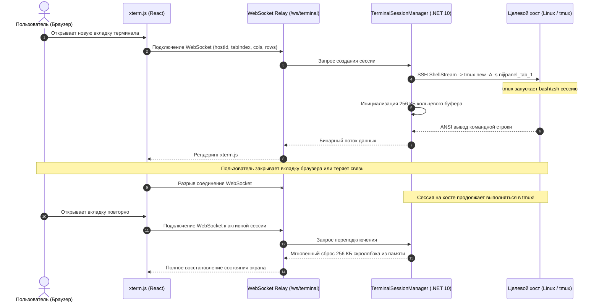

# 💻 SSH Web-терминал & tmux сессии

Модуль терминала в NijiPanel предоставляет полноценную командную строку Linux прямо в браузере с устойчивостью к обрывам связи и поддержкой серверных мультиплексированных сессий.

---

## ⚡ Ключевые возможности

* **Многовкладочный интерфейс:** открытие неограниченного числа независимых вкладок к любому серверу с возможностью переименования.
* **Неубиваемость сессий (tmux persistence):** закрытие вкладки, перезагрузка страницы или обрыв мобильного интернета **не завершают** запущенные процессы на сервере (сборка, htop, тяжелые скрипты продолжают работать).
* **256 КБ кольцевой буфер скроллбэка:** мгновенная загрузка всей истории вывода при переподключении.
* **Отслеживание реального каталога (Live CWD):** заголовок вкладки динамически отображает текущую рабочую директорию процесса (например, `~/projects/api` вместо статичного имени).
* **Нативная работа с буфером обмена:** выделенный текст автоматически копируется; вставка защищена от артефактов `~200` через стандарт Bracketed Paste Mode.
* **Полноценная эмуляция xterm.js:** 24-битная цветовая палитра TrueColor, поддержка Vim, Nano, Midnight Commander, Tmux, Htop, шрифтов Powerline и Nerd Fonts.

---

## 🏗️ Архитектура PTY и серверных сессий



---

## 🧭 Управление вкладками терминала

* **Создание вкладки:** кнопка `+` на панели вкладок создает новую изолированную сессию tmux на целевом сервере.
* **Переименование:** двойной клик по названию вкладки позволяет задать произвольное имя (например, `Logs`, `Build`, `Database`).
* **Отслеживание CWD:** в правой части вкладки отображается актуальный путь (`~/`, `/var/log`, `/etc/nginx`). Бэкенд периодически опрашивает рабочий каталог сессии через команду:
  ```bash
  tmux display-message -p -t nijipanel_tab_1 '#{pane_current_path}'
  ```
* **Закрытие вкладки:** при закрытии вкладки крестиком NijiPanel предлагает выбор:
  * **Detach:** отключиться от вкладки в браузере, сохранив процессы на сервере активными.
  * **Kill:** полностью завершить процессы и уничтожить сессию tmux на сервере.

---

## 📋 Буфер обмена и горячие клавиши

| Сочетание | Действие |
| :--- | :--- |
| `Ctrl + C` (при выделенном тексте) | Копирование выделенного текста в буфер обмена операционной системы. |
| `Ctrl + C` (без выделения) | Отправка стандартного сигнала прерывания SIGINT в терминал. |
| `Ctrl + V` / `Shift + Insert` | Вставка текста из буфера обмена с поддержкой Bracketed Paste Mode. |
| `Ctrl + Shift + +` / `-` | Изменение размера шрифта терминала на лету. |
| `Ctrl + L` | Очистка экрана с сохранением буфера прокрутки. |
