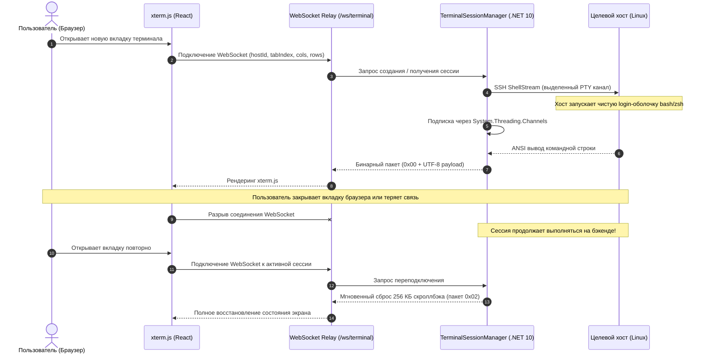

# 💻 SSH Web-терминал & Persistent PTY сессии

Модуль терминала в NijiPanel предоставляет полноценную командную строку Linux прямо в браузере с устойчивостью к обрывам связи и поддержкой серверных персистентных сессий в памяти бэкенда без необходимости установки утилит вроде `tmux` на целевой сервер.

---

## ⚡ Ключевые возможности

* **Многовкладочный интерфейс:** открытие неограниченного числа независимых вкладок к любому серверу с возможностью переименования.
* **Неубиваемость сессий (Agentless Backend Persistence):** закрытие вкладки, перезагрузка страницы или обрыв мобильного интернета **не завершают** запущенные процессы на сервере (сборка, htop, тяжелые скрипты продолжают работать). Сессию удерживает синглтон `TerminalSessionManager` в .NET 10.
* **Чистая история `.bash_history`:** прямое открытие ShellStream без инъекции команд запуска tmux в поток ввода пользователя.
* **Бинарный протокол Zero-Allocation:** обмен данными через WebSocket с 1-байтным префиксом (`0x00` поток I/O, `0x01` мгновенный ресайз `cols/rows`, `0x02` сброс скроллбэка).
* **256 КБ кольцевой буфер скроллбэка:** мгновенная загрузка всей истории вывода при переподключении без разрыва многобайтовых символов UTF-8.
* **Отслеживание реального каталога (Live CWD):** отслеживание пути по заголовку PTY / последовательностям OSC 7 без паразитных фоновых SSH-запросов.
* **Нативная работа с буфером обмена:** выделенный текст автоматически копируется; вставка защищена от артефактов `~200` через стандарт Bracketed Paste Mode.
* **Полноценная эмуляция xterm.js:** 24-битная цветовая палитра TrueColor, поддержка Vim, Nano, Midnight Commander, Htop, шрифтов Powerline и Nerd Fonts.

---

## 🏗️ Архитектура PTY и сессий

---

## 🧭 Управление вкладками терминала

* **Создание вкладки:** кнопка `+` на панели вкладок создает новую изолированную сессию PTY.
* **Переименование:** двойной клик по названию вкладки позволяет задать произвольное имя (например, `Logs`, `Build`, `Database`).
* **Отслеживание CWD:** в правой части вкладки отображается актуальный путь (`~/`, `/var/log`, `/etc/nginx`), считываемый из заголовка сессии.
* **Закрытие вкладки:** при закрытии вкладки крестиком NijiPanel освобождает ресурсы сессии и закрывает соответствующий канал ShellStream.

---

## 📋 Буфер обмена и горячие клавиши

| Сочетание | Действие |
| :--- | :--- |
| `Ctrl + C` (при выделенном тексте) | Копирование выделенного текста в буфер обмена операционной системы. |
| `Ctrl + C` (без выделения) | Отправка стандартного сигнала прерывания SIGINT в терминал. |
| `Ctrl + V` / `Shift + Insert` | Вставка текста из буфера обмена с поддержкой Bracketed Paste Mode. |
| `Ctrl + Shift + +` / `-` | Изменение размера шрифта терминала на лету. |
| `Ctrl + L` | Очистка экрана с сохранением буфера прокрутки. |
